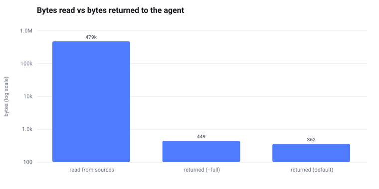
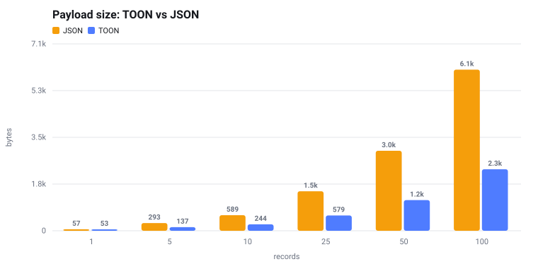
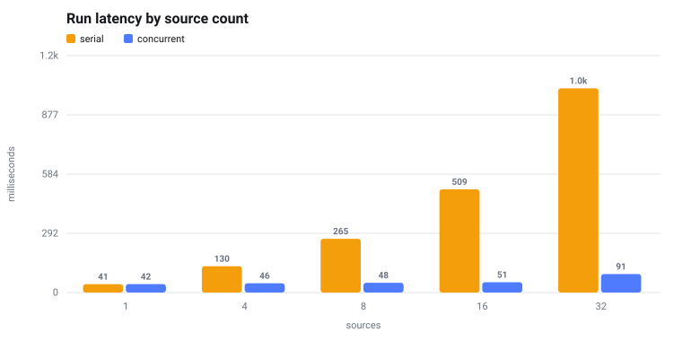

# pilotage

[](https://github.com/lambiengcode/pilotage/actions/workflows/ci.yml) [](LICENSE) [](https://www.rust-lang.org) [](https://axi.md) [](#development)

Research anything — a repository, a protocol, a vendor, an idea — and get back a verdict
with its evidence, not a wall of text.

```console
$ pilotage research github.com/tokio-rs/tokio
run[r_91ba6e]: oss, 5/5 sources, 1164ms, $0.0000
verdict: healthy
score: 98/100
coverage: 95%
confidence: 95%
issues[2]{metric,value,status,w}:
  security_policy,none,warn,1
  ci_status,unknown,unknown,1
ok[11]: archived,days_since_push,commits_90d,bus_factor,contributors,license,...
next: pilotage report r_91ba6e --html, pilotage watch add github.com/tokio-rs/tokio
```

<p align="center">
  
</p>

<p align="center">
  <i>One run across 12 sources: <b>479 KB read, 362 bytes returned</b>.</i>
</p>

---

## Highlights

- **Built for agents, not humans.** Output is [TOON](#output-format) — [62% smaller than
  JSON](#benchmarks) at scale, with a definitive empty state and a `next:` suggestion on
  every command.
- **A tool, not an agent.** Pilotage fetches, parses, caches and scores. The reasoning
  stays with whatever called it, which is already a reasoning loop and already paid for.
- **[Works on any subject](#the-topic-pack-any-subject-at-all).** The `topic` pack measures
  languages, frameworks, drugs, diseases, markets and ideas from 11 free keyless sources.
- **[Verticals are TOML files](#writing-your-own-pack).** Adding a domain means adding a
  file, loaded at runtime. No recompile.
- **Cheap by construction.** A [three-rung extraction ladder](#the-extraction-ladder)
  calls a model only for what selectors cannot reach, then caches it against the content
  hash forever.
- **Honest by construction.** Nothing is dropped silently: every skipped rung, failed
  source and unmeasurable metric is named. Sources that disagree are
  [reported, not reconciled](#scoring).
- **Fast.** [5.9 ms startup](#benchmarks), 16× concurrent fetch, 9.5 ms warm runs, a
  single 8.9 MB static binary.

## Table of contents

- [Installation](#installation)
- [Quick start](#quick-start)
- [Commands](#commands)
- [Output format](#output-format)
- [Packs](#packs)
- [The extraction ladder](#the-extraction-ladder)
- [Probes](#probes)
- [Configuration](#configuration)
- [Benchmarks](#benchmarks)
- [Architecture](#architecture)
- [What pilotage will not do](#what-pilotage-will-not-do)
- [Development](#development)

## Installation

```bash
curl -fsSL https://raw.githubusercontent.com/lambiengcode/pilotage/main/install.sh | sh
```

Detects your platform, downloads the matching release binary, verifies its SHA-256, and
installs to `~/.local/bin`. Prebuilt for Linux and macOS on x86_64 and aarch64; Windows
binaries are on the [releases page](https://github.com/lambiengcode/pilotage/releases).

<details>
<summary><b>Other ways to install</b></summary>

```bash
# Pin a version, or install somewhere else
PILOTAGE_VERSION=0.1.0 PILOTAGE_INSTALL_DIR=/usr/local/bin \
  sh -c "$(curl -fsSL https://raw.githubusercontent.com/lambiengcode/pilotage/main/install.sh)"
```

```bash
# From source — requires Rust 1.88+
cargo install --git https://github.com/lambiengcode/pilotage
```

```bash
# From a clone
cargo build --release && cp target/release/pilotage ~/.local/bin/
```

The installer honours `PILOTAGE_VERSION`, `PILOTAGE_INSTALL_DIR`, `PILOTAGE_REPO` and
`PILOTAGE_BASE_URL` (for mirrors or air-gapped installs), and takes `--dry-run`.

</details>

One self-contained binary, no runtime.

<details>
<summary><b>Optional companions</b></summary>

| Tool | Needed for | Install |
| --- | --- | --- |
| `chrome-devtools-axi` | `kind = "browser"` sources — client-rendered pages | `npm i -g chrome-devtools-axi` |
| `lavish-axi` | opening HTML reports for annotation | `npm i -g lavish-axi` |

</details>

<details>
<summary><b>Agent integration</b></summary>

```bash
pilotage setup hooks             # print the SessionStart hook
pilotage setup hooks --install   # merge into ~/.claude/settings.json
```

Installs a hook that runs `pilotage ambient`, so a session opens already knowing what is
being watched and what moved. Idempotent, and keeps a `.bak`.

</details>

## Quick start

```bash
pilotage                                     # dashboard: recent runs, watches, cache
pilotage research github.com/rust-lang/rust  # detects the oss pack
pilotage research stripe.com                 # detects the saas pack
pilotage research "topic:WebAssembly"        # any subject at all
pilotage research aave --pack crypto         # force a pack for a bare slug
```

Compare a set and get a side-by-side report:

```bash
pilotage compare heygen.com synthesia.io d-id.com tavus.io \
  --depth deep --html report.html --title "HeyGen vs alternatives"
```

Track drift over time:

```bash
pilotage watch add github.com/rust-lang/rust
pilotage watch check    # diffs against the last run, reports only what moved
```

[`docs/example-comparison.html`](docs/example-comparison.html) is a real report produced
by that command.

## Commands

| Command | What it does |
| --- | --- |
| `pilotage` | Dashboard — live data, never help text |
| `pilotage research <target>` | Verdict, signals and provenance for one target |
| `pilotage compare <a> <b> …` | Pivot several targets across the same metric set |
| `pilotage report [run]` | Re-render a stored run; `--html` writes a report |
| `pilotage source list\|get` | Inspect what a run actually read |
| `pilotage watch add\|list\|rm\|check` | Track targets and diff them against their last run |
| `pilotage pack list\|show\|validate` | Inspect and check packs |
| `pilotage cache stats\|prune` | Cache maintenance |
| `pilotage setup hooks` | Agent integration |

<details>
<summary><b><code>research</code> flags</b></summary>

```
--pack <name>       force a pack instead of detecting one
--depth quick|deep  deep adds slower and optional sources (default: quick)
--budget <usd>      hard ceiling for model extraction
--fields a,b,c      columns: metric,label,value,status,w,conf,source,url
--full              show every signal, not just the problems
--no-cache          refetch, ignoring cached responses
--json              full run as JSON
--html <path>       also write a self-contained HTML report
```

The default view returns only what is **wrong**, plus the names of what is fine. Healthy
metrics are the bulk of any run and the least interesting part of it, so they cost one
line between them instead of one line each.

</details>

<details>
<summary><b><code>compare</code> and its report</b></summary>

```console
$ pilotage compare github.com/rust-lang/rust github.com/denoland/deno
compare[2]{target,pack,verdict,score,coverage,cost}:
  github.com/rust-lang/rust,oss,healthy,96,95%,$0.0000
  github.com/denoland/deno,oss,healthy,96,95%,$0.0000
metrics[13]{metric,rust,deno}:
  days_since_push,0.0d,2.0d
  bus_factor,21,23
  license,Apache-2.0,MIT
  open_issues,12713,1502
concerns[2]{metric,rust,deno}:
  security_policy,warn,warn
  open_issues,warn,warn
```

`--html` writes a side-by-side report: a card per subject, metrics ordered by weight,
cells coloured by status, full provenance, and a closing section naming every dimension
that could **not** be measured.

`--budget` is the ceiling for the whole comparison, split evenly. Targets are researched
sequentially, so comparing eight competitors is not eight simultaneous bursts at the same
APIs.

</details>

## Output format

TOON hoists repeated record keys into a single header row:

```
verdict: caution                       scalar
tags[3]: a,b,c                         list
signals[2]{k,v,conf}:                  table header
  tvl_30d,-42%,high                    records
  commits_90d,3,high
results[0]: none                       definitive empty state
next: pilotage report r_18f2 --html    contextual disclosure
```

Rules that hold everywhere:

- **Empty is explicit.** `key[0]: none`, never a blank. An agent must never have to guess
  whether "no output" meant "no data" or "it broke".
- **Nothing is dropped silently.** Every skipped rung, failed source and missing
  credential appears in `degraded`.
- **Every command ends with `next:`.** What is worth running now, given what just happened.
- **No interactive prompts, ever.** `watch add` twice is one watch.

### Exit codes

| Code | Meaning |
| --- | --- |
| `0` | Success — including a run that legitimately found nothing |
| `1` | Usage: unknown target, bad flag, no matching pack, invalid pack |
| `2` | A required credential or configuration is missing |
| `3` | Every source failed (partial failure stays `0` and reports `degraded`) |
| `4` | The cost ceiling stopped work before the run finished |

## Packs

A pack declares what to fetch, how to pull facts out, and which thresholds turn those
facts into a verdict. The engine knows nothing about any domain.

| Pack | Sources | Metrics | Recognises |
| --- | --: | --: | --- |
| [`topic`](#the-topic-pack-any-subject-at-all) | 11 | 13 | **anything** — `topic:{q}`, `t:{q}` |
| `oss` | 7 | 13 | `github.com/{owner}/{repo}`, `{owner}/{repo}` |
| `crypto` | 5 | 15 | `defillama.com/protocol/{slug}`, `coingecko.com/en/coins/{slug}` |
| `saas` | 7 | 12 | any bare hostname, `saas:{host}` |
| `aivideo` | 11 | 30 | ten named AI-video vendors, `aivideo:{host}` |
| [`probe`](#probes) | 4 | 8 | `latency`, `probe:{name}` — **never auto-detected** |

Built-ins are compiled into the binary. Anything in `~/.pilotage/packs/*.toml` loads at
runtime and **overrides a built-in of the same name**, which is how a shipped pack gets
patched without waiting for a release.

### The `topic` pack: any subject at all

The other packs are verticals: they know what a repository or a protocol is. `topic` knows
nothing about its target and works on anything you can name.

```console
$ pilotage compare "topic:Rust (programming language)" \
                   "topic:Go (programming language)" \
                   "topic:Zig (programming language)"
metrics[13]{metric,Rust,Go,Zig}:
  matched_article,Rust (programming language),Go (…),Zig (…)
  attention_trend_24m,6.6%,-23.5%,113.1%
  attention_now,47114.3,29066,21961.7
  research_volume,78,69,3
  research_momentum,0.3,0.2,1
  dev_ecosystem,7913,9637,536
```

```console
$ pilotage research "topic:CRISPR"
  medical_literature,70081   research_volume,49051   attention_trend_24m,-25.4%
```

Eleven free, keyless sources: Wikipedia search and **24 months of pageviews** (the one
universal trend line), OpenAlex total and last-12-months (research momentum), PubMed,
Crossref, GitHub search, Stack Overflow, npm, and Hacker News stories and comments.

> [!IMPORTANT]
> `topic` measures a **string**, not a concept. Bare `topic:Go` matches the board game and
> reports 227,000 medical papers; `topic:Go (programming language)` drops that to 133. The
> `matched_article` metric is pinned, so every run shows which Wikipedia article the query
> actually landed on.

Read the verdict as *how established and active* a subject is, not whether it is
"healthy" — health is not a property of an idea.

### Writing your own pack

```toml
name = "npm"
detect = ["npmjs.com/package/{pkg}", "npm:{pkg}"]

[[source]]
id = "registry"
kind = "api"                       # api | html | browser | probe
url = "https://registry.npmjs.org/{pkg}"
ttl = "6h"
[source.map]
license = ".license"
maintainers = ".maintainers"
modified = ".time.modified"

[[metric]]
id = "days_since_publish"
fact = "modified"
agg = "days_since"                 # count sum avg max min first unique days_since pct_change ratio
warn = "> 365"
fail = "> 1095"
weight = 3.0
unit = "d"
```

```console
$ pilotage research npmjs.com/package/express
run[r_b541b8]: npm, 2/2 sources, 252ms, $0.0000
verdict: healthy
```

The complete file is at [`docs/example-pack-npm.toml`](docs/example-pack-npm.toml).
`pilotage pack validate` catches duplicate ids, thresholds that do not parse, and metrics
pointing at facts no source produces.

<details>
<summary><b>Pack reference</b></summary>

**URL and body variables.** Captures from the matched `detect` pattern, plus `{target}`,
`{slug}`, `{host}`, `{domain}`, `{brand}` (host without its TLD), and the date windows
`{today}`, `{since_7d}`, `{since_30d}`, `{since_90d}`, `{since_1y}`, `{since_2y}`. Every
variable also has `_enc` (percent-encoded) and `_us` (spaces to underscores) spellings, and
`{env.NAME}` reads the environment.

**JSON paths.** `.a.b`, `.a[0]`, `.a[].b` (map across an array), `.a{}` (object keys as a
list), `.` for the whole document.

**Selectors.** `css`, plus optional `attr`, `all`, and a narrowing `regex` whose first
capture group wins. Omit `css` and the regex runs over plain text — how rendered browser
snapshots are read.

**Narrowing a list before counting it.** `filter = "<regex>"` keeps only matching array
elements, before `take` and before the aggregation. This turns a raw list into an
answerable question: not "how many incidents" but "how many mentioned latency". A filter
that fails to compile yields *missing*, never the unfiltered count.

**Always showing a value.** `pin = true` keeps a metric's value in the compact view even
when it passes.

**Making units comparable.** `agg = "ratio"` with `over = "<fact>"` divides one fact by
another — what makes a credit-priced vendor comparable to a minute-priced one. The model
extracts both numbers as written; pilotage does the division. Arithmetic belongs in the
engine, never in a prompt.

```toml
[[metric]]
id = "cost_per_minute"
fact = "lowest_paid_price_usd"
over = "entry_plan_minutes_per_month"
agg = "ratio"
warn = "> 2"
```

</details>

## The extraction ladder

Rungs run in order and stop paying as early as possible.

| Rung | Method | Cost | Coverage |
| --: | --- | --- | --- |
| 1 | JSON field map | free | ~70% |
| 2 | CSS / regex selectors | free | ~20% |
| 3 | cheap-model extraction | paid | ~10% |

Rung 3 is keyed on `(content_hash, extractor_version)` and cached permanently: an
unchanged page is never paid for twice, and changing one selector invalidates exactly the
affected entries. An extraction that was *skipped* — no key, budget exhausted — is
deliberately **not** cached, so configuring a key later actually takes effect.

**Model routing.** A pack asks for a capability tier, not a vendor: `flash` (Gemini) for
bulk extraction, falling back to `mini` (OpenAI) when no Gemini key is set; `long`
(DeepSeek) for cheap long context; the caller for everything else. The model is told to
extract and nothing else — every fact carries its source URL, and a fact with no
retrievable source is dropped rather than reported.

**Budget.** `--budget 0.05` is a hard ceiling checked *before* each call. On approach,
model extraction is dropped from the lowest-weight sources first, the drop is named in
`degraded`, and the run exits `4`. No silent truncation.

## Probes

`kind = "probe"` is the only source kind that **measures** rather than reads: it POSTs a
real job, polls to a terminal state, and synthesises a document the ordinary field map
then reads — `.probe.latency_s`, `.probe.ok`, `.probe.polls`, `.probe.status`.

> [!WARNING]
> Probes spend the vendor's credits. Three rules are enforced rather than documented: the
> credential gate is checked **before the socket opens**, `pack validate` refuses a probe
> with no `auth_env`, and the probe pack is never auto-detected. A market scan cannot
> quietly generate billable video.

Before reaching for this, note that public status-page incident logs already give latency
*evidence* for free — see `latency_incidents` in the `aivideo` pack.

<details>
<summary><b>Probe definition</b></summary>

```toml
[[source]]
id = "heygen"
kind = "probe"
url = "https://api.heygen.com/v2/video/generate"
method = "POST"
depth = "deep"
auth_env = "HEYGEN_API_KEY"
auth_header = "X-Api-Key"
auth_format = "{}"
auth_required = true
body = '''{"video_inputs":[{"character":{"avatar_id":"{env.HEYGEN_AVATAR_ID}"}}]}'''
[source.poll]
url = "https://api.heygen.com/v1/video_status.get?video_id={id}"
id_path = ".data.video_id"
status_path = ".data.status"
done = ["completed"]
failed = ["failed"]
interval = "5s"
timeout = "6m"
```

A probe that times out returns `ok=false` with HTTP 200 — "this vendor did not finish in
six minutes" is a *measurement* and belongs in the comparison, not in the degraded list.
Results cache for a day, because repeating a measurement costs real money.

</details>

## Configuration

| Variable | Default | Purpose |
| --- | --- | --- |
| `PILOTAGE_HOME` | `~/.pilotage` | Cache and user packs |
| `PILOTAGE_CONCURRENCY` | `16` | Parallel fetches |
| `PILOTAGE_TIMEOUT_SECS` | `20` | Per-request timeout |
| `PILOTAGE_HOST_INTERVAL_MS` | `200` | Minimum gap between requests to one host |
| `PILOTAGE_REPLAY` | unset | Cache-only mode; never touches the network |
| `PILOTAGE_IGNORE_ROBOTS` | unset | Skip robots.txt for markup fetches |
| `PILOTAGE_BROWSER_BIN` | `chrome-devtools-axi` | Browser transport |
| `GITHUB_TOKEN` | — | 60/h → 5000/h on the `oss` pack |
| `GEMINI_API_KEY` / `OPENAI_API_KEY` / `DEEPSEEK_API_KEY` | — | Enable rung 3 |
| `PILOTAGE_PRICE_{FLASH,MINI,LONG}_{IN,OUT}` | list prices | USD per million tokens, for budgeting |

> [!NOTE]
> **robots.txt** is enforced for `html` and `browser` sources, which crawl. It is *not*
> applied to `kind = "api"` sources: robots governs crawling, and a documented API endpoint
> that a pack author named and a user deliberately invoked is not crawling. CoinGecko's
> robots.txt disallows `/api/`, aimed at search engines.

## Benchmarks

Measured, not modelled. `cargo run --release --bin bench` regenerates everything below and
writes [`docs/bench.md`](docs/bench.md). Medians of 7 runs against a local server with
25 ms injected latency, on macOS / aarch64.

### Context economics

The premise of the whole tool: what comes back is bounded by the number of *problems*, not
by how much was read.

| | bytes | tokens\* |
| --- | --: | --: |
| read from sources | 479,335 | 119,834 |
| returned, `--full` | 449 | 113 |
| returned, default view | **362** | **91** |

**1324× reduction** on the default view.

### Payload size — TOON vs JSON



| records | TOON | JSON | saving |
| --: | --: | --: | --: |
| 1 | 53 | 57 | 7% |
| 10 | 244 | 589 | 59% |
| 50 | 1160 | 3025 | 62% |
| 100 | 2327 | 6091 | 62% |

Key hoisting pays more the more records there are, and barely pays for one — which is why
pilotage uses scalars, not tables, for singletons.

### Fan-out and latency



| sources | serial | concurrent | speedup |
| --: | --: | --: | --: |
| 4 | 129.9 ms | 45.5 ms | 2.9× |
| 8 | 265.3 ms | 48.2 ms | 5.5× |
| 16 | 509.1 ms | 51.0 ms | 10.0× |
| 32 | 1007.7 ms | 91.3 ms | 11.0× |

| | |
| --- | --: |
| cold run, 8 sources | 43.9 ms |
| warm run, from cache | 9.5 ms |
| process startup | **5.9 ms** |

Startup is the floor under every invocation, and an agent pays it dozens of times a
session. It is why this is a Rust binary rather than a Node CLI behind `npx`.

> [!NOTE]
> \* Token counts are approximate at 4 characters per token. **Model cost and end-to-end
> agent token spend are deliberately not benchmarked** — the first depends on provider keys
> and is accounted at run time from reported usage; the second depends on the calling model
> and task. Publishing invented numbers for either would be worse than leaving them out.

## Architecture

```
                 agent (Claude Code)
                        │  TOON in / TOON out, 1–3 calls
                        ▼
        ┌───────────────────────────────────┐
        │  pilotage  (single Rust binary)   │
        │                                   │
        │  cmd/    ── clap dispatch         │
        │  pack    ── declarative TOML      │
        │  fetch   ── tokio pool, 16× conc. │
        │  extract ── deterministic → LLM   │
        │  score   ── metrics → verdict     │
        │  toon    ── serializer            │
        └───┬──────────┬─────────┬──────────┘
            │          │         │
       SQLite      chrome-      Gemini / OpenAI
      (1 file)   devtools-axi   / DeepSeek
     L1 blobs    (JS-heavy       (extraction
     L2 facts     pages only)     fallback only)
     L3 runs
```

| Module | Responsibility |
| --- | --- |
| `toon.rs` | The serializer every output path goes through |
| `pack.rs` | Pack model, target detection, threshold expressions |
| `fetch.rs` | Concurrent I/O, rate limiting, robots, replay, probe timing |
| `extract/` | The ladder: `det.rs` (rungs 1–2), `llm.rs` (rung 3 + budget) |
| `score.rs` | Metrics → signals → verdict, unknown kept distinct from absent |
| `cache.rs` | Three-tier SQLite: blobs, extractions, runs |
| `research.rs` | Orchestration |
| `report.rs` | Self-contained HTML, single-run and side-by-side |

### Cache tiers

One SQLite file, no server.

| Tier | Contents | Key | Expiry |
| --: | --- | --- | --- |
| L1 | raw responses | URL | per-source TTL |
| L2 | extracted facts | content hash + extractor version | never |
| L3 | complete runs | run id | 90 d (`cache prune`) |

L3 is what makes `compare` and `watch` nearly free — they diff stored runs rather than
researching again. `cache prune` drops blobs and runs but **keeps L2**: extractions are
immutable, small, and the expensive thing to recompute.

### Scoring

Each signal is `ok` / `warn` / `fail` / `unknown`; the verdict is a weighted rollup, and a
failing `critical` metric forces `risk` regardless of the rest. Below 40% coverage
pilotage returns `insufficient-data` rather than scoring whatever happened to arrive.

The distinction that matters: a metric whose source **never ran** is `unknown`, while a
metric whose source ran and found nothing is `missing`. Conflating them either invents
confidence or fires a warning about data nobody looked for.

When two sources disagree beyond the pack's tolerance, the disagreement is **reported as a
contradiction, not reconciled** — sources conflicting is a finding about the target, not
noise to smooth away.

## What pilotage will not do

| Not this | Why |
| --- | --- |
| **Find alternatives to X** | Discovery is a judgement call. You name the subjects; the calling agent is good at that. Adding it would mean adding inference. |
| **Summarise or explain** | Pilotage returns measurements. Synthesis is the caller's job and is already paid for. |
| **Judge code quality** | It measures activity, governance and metadata around a repo, not what is in it. |
| **Compare across packs** | `compare` pivots on metric *id*. Two packs sharing no metric names produce a table of dashes. |
| **Read PDFs or filings** | Sources are JSON, HTML and rendered pages. |
| **Log-in-gated pages** | Anonymous or API-key authenticated only. No OAuth, no session replay. |
| **Load-test anything** | Probes measure one job per vendor per day. |
| **Reconstruct history** | It keeps what sources return, plus your own stored runs. |

<details>
<summary><b>Deliberately skipped, and when to add it</b></summary>

| Skipped | Add when |
| --- | --- |
| Vector DB / embeddings | keyword lookup measurably misses relevant stored facts |
| Web UI or dashboard server | someone other than an agent needs to read this |
| Job queue / scheduler | `watch` outgrows the user's cron |
| Multi-tenancy, auth, billing | it stops being a local CLI |
| An embedded browser | `chrome-devtools-axi` stops covering the JS-heavy cases |
| A plugin ABI for packs | TOML packs stop being expressive enough |

</details>

## Development

```bash
cargo test                          # 248 tests: unit + end-to-end
cargo run --release --bin bench     # regenerate docs/bench.md and the plots
cargo run -- research <target>
```

Integration tests drive the compiled binary against a local mock server, so exit codes,
argument parsing and TOON output are covered by the same assertions. Each test gets a
private `PILOTAGE_HOME` and its own server, so nothing touches the network and the suite
runs in parallel.

`PILOTAGE_REPLAY=1` serves the cache and refuses to reach the network, so a recorded run
replays deterministically — including in CI, offline.

CI runs fmt, clippy, the full suite on Linux, macOS and Windows, an MSRV check against the
`rust-version` in `Cargo.toml`, `pack validate` on the shipped packs, and shellcheck on the
installer.

### Releasing

```bash
# 1. move the Unreleased section of CHANGELOG.md under a new version heading
# 2. bump `version` in Cargo.toml, then
git tag v0.2.0 && git push origin v0.2.0
```

The tag triggers [`release.yml`](.github/workflows/release.yml), which builds native
binaries for x86_64 and aarch64 Linux and macOS plus x86_64 Windows, verifies each one
runs and validates its packs, publishes archives with a `SHA256SUMS` file, and uses that
version's changelog section as the release notes.

## Acknowledgements

Built on the [AXI](https://axi.md) design principles for agent-ergonomic CLIs, alongside
`gh-axi`, `chrome-devtools-axi` and `lavish-axi`.

## License

[MIT](LICENSE)
