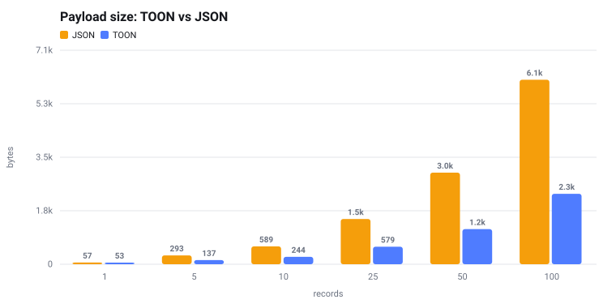
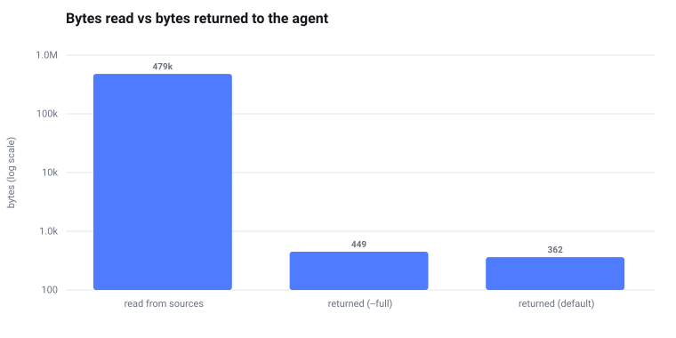
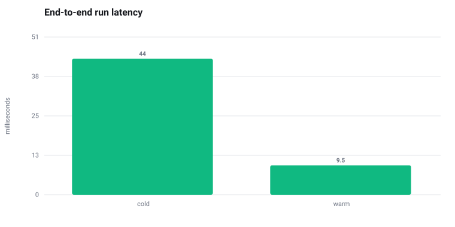
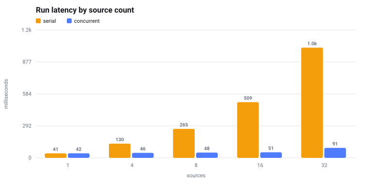

# Benchmarks

Generated by `cargo run --release --bin bench`. Medians of 7 runs against a local server with 25ms injected latency, on macos / aarch64.

## 1. Payload size — TOON vs JSON

The same signal table serialised both ways. TOON hoists the record keys into a single header row, so the saving grows with the number of records and is negative for a single one — which is why pilotage uses scalars, not tables, for singletons.

| records | TOON bytes | JSON bytes | saving | TOON tokens* | JSON tokens* |
|--:|--:|--:|--:|--:|--:|
| 1 | 53 | 57 | 7% | 14 | 15 |
| 5 | 137 | 293 | 53% | 35 | 74 |
| 10 | 244 | 589 | 59% | 61 | 148 |
| 25 | 579 | 1494 | 61% | 145 | 374 |
| 50 | 1160 | 3025 | 62% | 290 | 757 |
| 100 | 2327 | 6091 | 62% | 582 | 1523 |

\* approximate, at 4 characters per token.

## 2. Context economics

One run over 12 sources returning 40 KB each. `bytes read` is what the sources actually returned — what would land in an agent's context window if it fetched them itself. `bytes returned` is what pilotage hands back.

| | bytes | tokens* |
|:--|--:|--:|
| read from sources | 479335 | 119834 |
| returned, default view | 362 | 91 |
| returned, `--full` | 449 | 113 |

**1324× reduction** on the default view.

## 3. Cache — cold vs warm

Eight sources at 25ms each, end to end including process startup.

| | ms |
|:--|--:|
| cold (all sources fetched) | 43.9 |
| warm (served from cache) | 9.5 |

**5× faster** warm.

## 4. Fan-out — serial vs concurrent

The same run with `PILOTAGE_CONCURRENCY=1` and at the default of 16, against sources that take 25ms each. Serial cost grows with source count; concurrent cost is roughly one round trip until the pool saturates.

| sources | serial ms | concurrent ms | speedup |
|--:|--:|--:|--:|
| 1 | 41.4 | 41.8 | 1.0× |
| 4 | 129.9 | 45.5 | 2.9× |
| 8 | 265.3 | 48.2 | 5.5× |
| 16 | 509.1 | 51.0 | 10.0× |
| 32 | 1007.7 | 91.3 | 11.0× |

## 5. Process startup

`pilotage --version`, 21 reps: **5.9ms** median. This is the floor under every invocation, and it is why the binary is Rust rather than a Node CLI behind `npx`.

## What is not measured here

* **Model cost.** Rung 3 only runs with a provider key configured. Pilotage accounts for it from the provider's reported token usage at run time; there is no fixed number to publish, and inventing one would be worse than leaving it out.
* **End-to-end agent token spend.** That depends on the calling model and the task. The payload measurements above are the part pilotage controls.
